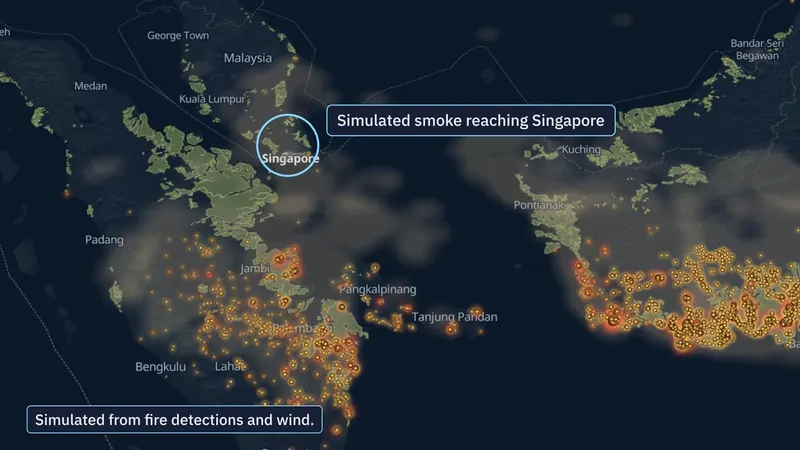

# LionWeather
<p align="center">
  <a href="https://kooexperience.com/blog/posts/lionweather.html"></a>
  <br>
  <a href="https://lionweather.kooexperience.com/?tour=1">▶ 30-second tour</a> · <a href="https://lionweather.kooexperience.com/">Live app</a> · <a href="https://kooexperience.com/blog/posts/lionweather.html">kooexperience.com</a>
  <br>
  <sub>Music: Sascha Ende, ende.app (CC BY 4.0)</sub>
</p>

Singapore weather intelligence - NEA real-time data, ML-powered rainfall forecasting, a rain map from NEA rain gauges, and a 3D haze map.

**Live:** [lionweather.kooexperience.com](https://lionweather.kooexperience.com)

## Features

- **Real-time weather** - temperature, rainfall, humidity, wind, UV, visibility, pressure from [data.gov.sg](https://api-open.data.gov.sg) (polled every 10 min)
- **7-day forecast** - NEA 4-day outlook extended with Open-Meteo, labelled by SGT date
- **Hourly forecast** - next 24 hours with weather icons, precip probability, sunrise/sunset markers
- **Weather cards** - Feels Like (Steadman heat index), dew point, wind compass, rainfall intensity, UV index
- **Rain map** - the last two hours of NEA rain-gauge readings, interpolated between gauges, in 2D or 3D with drawn rain, with a scrub slider and intensity legend
- **Haze map** (`/haze`) - PSI and PM2.5 by region in 3D, air paths from Open-Meteo wind, NASA fire detections, peatland, simulated smoke drift and a street-level wind simulation
- **ML rain forecast** - LightGBM 3-class classifier (No Rain / Light / Heavy+Thundery), 1-12h ahead
- **ML analysis dashboard** - EDA, ACF/PACF, SHAP feature importance, confusion matrix, NEA benchmark
- **Multi-location** - save locations by search or map pin, NEA area name snapping
- **Privacy** - coordinates go to the server only to find the nearest station and are not stored (see `/privacy`)

## Stack

| Layer | Tech |
|-------|------|
| Frontend | React 18, Vite, Tailwind CSS, Leaflet (OpenStreetMap tiles), MapLibre (OpenFreeMap tiles) |
| Backend | FastAPI, SQLAlchemy, PostgreSQL (Railway) / SQLite (local) |
| ML | LightGBM, SHAP, statsmodels |
| Data sources | Singapore data.gov.sg (NEA, including rain gauges), Open-Meteo, NASA FIRMS, OpenStreetMap, PEATMAP, geoBoundaries |
| Deployment | Railway (Railpack), two services with watch paths |

## Project structure

```
lionweather/
├── frontend/
│   └── src/
│       ├── components/           # UI: weather cards, rain map, ML dashboard
│       ├── hooks/useLocations.jsx # Location state, weather refresh, notifications
│       ├── api/                  # API clients (unified base URL from base.js)
│       └── pages/Dashboard.jsx
├── backend/
│   ├── app/
│   │   ├── main.py              # FastAPI app, lifespan, background tasks
│   │   ├── routers/             # 17 route modules
│   │   ├── services/            # Data collection, rain gauges, haze scene, weather API
│   │   ├── db/database.py       # Singleton SQLAlchemy engine (PostgreSQL/SQLite)
│   │   └── ml/                  # ML scheduler, prediction engine
│   ├── ml/                      # Training scripts (local only)
│   ├── models/                  # ML artifacts (committed)
│   │   └── full_analysis.json
│   ├── requirements.txt         # Production deps only
│   └── requirements-dev.txt     # Dev/training deps (tensorflow, pytest, etc.)
├── backend/railway.json         # Backend deploy config
├── frontend/railway.json        # Frontend deploy config
└── railway.toml                 # Root Railway config
```

## Running locally

### Backend

```bash
cd backend
python3 -m venv .venv && source .venv/bin/activate
pip install -r requirements-dev.txt

cp .env.example .env  # set ADMIN_SECRET, WEATHERAPI_KEY
uvicorn app.main:app --reload --port 8000
```

API docs at `http://localhost:8000/docs`

### Frontend

```bash
cd frontend
npm install
npm run dev
```

App at `http://localhost:5173` - Vite proxies `/api` to `localhost:8000`

## ML training

Training runs locally (NEA historical dataset is ~46 GB, too large for Railway):

```bash
cd backend && source .venv/bin/activate
python -m ml.train_full_analysis
```

Writes `backend/models/full_analysis.json`. Commit and push - Railway serves it via `/api/ml/full-analysis`.

**Rain classification (3-class):**

| Class | Label | Rainfall |
|-------|-------|----------|
| 0 | No Rain | < 0.1 mm/hr |
| 1 | Light Rain | 0.1-7.6 mm/hr |
| 2 | Heavy + Thundery | >= 7.6 mm/hr |

**Training data:** NEA historical CSVs 2016-2024, temporal split (train 2016-2022 / val 2023 / test 2024), no data leakage.

**Top SHAP features:** `dry_spell_hours` (#1), `humidity` (#2), `wind_accel_3h` (#3).

**Accuracy (test 2024):** 1h = 69.9%, 3h = 62.2%, 6h = 59.2%, 12h = 57.5%

## Deployment

Both services deploy from `main` via Railway (Railpack builder):

- **Backend:** `uvicorn app.main:app --host 0.0.0.0 --port $PORT` with health check at `/health`
- **Frontend:** `npm run build` (build phase) then `serve -s dist` (runtime)
- **Watch paths:** `backend/**` and `frontend/**` prevent cross-service rebuilds
- **CORS:** configured for `lionweather.kooexperience.com` and Railway preview URLs

### Environment variables (Railway backend)

```
ADMIN_SECRET=       # Required - protects /admin/* endpoints
WEATHERAPI_KEY=     # Required - NEA data.gov.sg API key
DATABASE_URL=       # Auto-set by Railway PostgreSQL plugin
```

### Admin endpoints

Protected by `X-Admin-Secret` header:

```
POST /admin/retrain            # Trigger ML retraining
GET  /admin/retrain-status     # Poll retraining progress
POST /admin/collect-now        # Force weather data collection
POST /admin/collect-forecasts  # Force forecast collection
GET  /admin/export             # Export weather records (CSV/JSON)
POST /admin/remove-duplicates  # Deduplicate weather_records table
```

### Monitoring

```
GET /health                    # DB connectivity check (used by Railway health check)
GET /status                    # Data counts, latest timestamps, background service state
GET /api/data-health/status    # Health score, gap detection, row counts
```

Full API reference at `/docs`.

## License

MIT

## Built by

[Haoming Koo](https://kooexperience.com)
